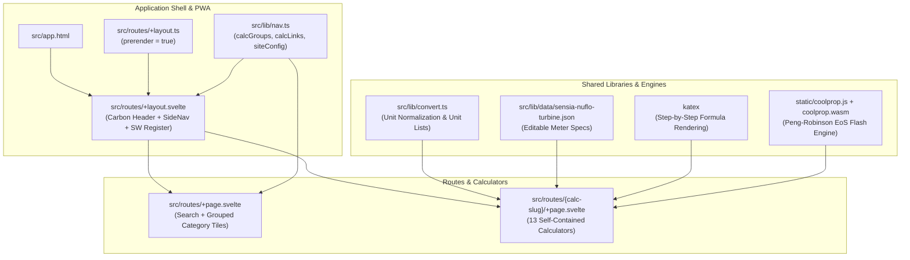

# CODEBASE.md — Hardo's Engineering Calculator Collection

> *"Engineering calculations on the go."*
> A zero-backend, offline-first Progressive Web App (PWA) for Process Analyzer, Instrumentation, and Sampling System Engineering.

---

## 1. The Narrative & Origin Story

### Why This Project Exists
In process plants, refineries, power stations, and offshore facilities, **Process Analyzer & Instrumentation Engineers** constantly perform specialized calculations:
- Designing sample conditioning and transport lines (calculating transport lag time, tube heat loss, and friction pressure drop).
- Verifying mechanical integrity of sample probes and thermowells inserted into high-velocity pipes (ASME PTC 19.3 wake frequency resonance and IEC 61831 flow-induced bending stress).
- Predicting phase behavior to prevent condensation inside sample lines and analyzers (Water Dew Point, $\text{H}_2\text{SO}_4$ Acid Gas Dew Point, and multi-component Hydrocarbon Dew Point).
- Selecting and calibrating flow and analytical instruments (Sensia NuFlo liquid turbine meter sizing, 4–20 mA analog loop scaling, span factor corrections, and $\text{ppmv} \leftrightarrow \text{mg/m}^3$ gas concentration conversions).

Historically, these calculations lived in scattered personal Excel spreadsheets (such as `Gas Concentration Conversion.xlsx`), dog-eared PDF standards, or heavyweight desktop simulation tools—none of which are convenient on a phone or tablet while standing inside an analyzer shelter with spotty Wi-Fi.

### How the Codebase Evolved
1. **Prototype to Industrial UI**: Started as a SvelteKit 2 + Svelte 5 project (originally prototyped with DaisyUI, leaving small historical footprints like `data-theme="cupcake"` in [`src/app.html`](file:///Users/haranobuhardo/programming/js/engineering-calc/src/app.html) and `"svelte-weebz-calc"` in [`package.json`](file:///Users/haranobuhardo/programming/js/engineering-calc/package.json)). It quickly pivoted to **IBM Carbon Design System (`g10` theme)** to embrace a crisp, dense, industrial utility aesthetic.
2. **From Black-Box Answers to Glass-Box Derivations**: Rather than just spitting out a number, **KaTeX** was integrated into every calculator so each run generates a live, step-by-step mathematical derivation substituting the engineer's actual unit-converted numbers into the governing equation.
3. **Offline Field Readiness**: Converted into a fully prerendered Static Site + Workbox PWA so every page, font, and equation works 100% offline after initial load.
4. **Full Thermodynamic Engine in the Browser**: Culminated in compiling **CoolProp** (C++ thermodynamic library) to WebAssembly (`static/coolprop.wasm`), enabling real Peng-Robinson Equation of State (EoS) vapor-liquid equilibrium flash calculations directly in the browser without a backend server.

---

## 2. Core Philosophy & Design Tenets

### I. Glass-Box Engineering ("Show Your Work")
Engineers do not trust black-box numbers when sizing a high-pressure sample probe or setting heat-trace temperatures. Every calculator renders intermediate equations and substituted values using **KaTeX** (`displayMode: true, fleqn: true`). Furthermore, [`src/app.css`](file:///Users/haranobuhardo/programming/js/engineering-calc/src/app.css) includes `@media print` rules that strip away the Carbon navigation shell so any calculation page can be printed directly to PDF/paper as a formal calculation sheet.

### II. Zero-Backend, Offline-First Field Architecture
There is **no backend server, no database, and no API layer**.
- Every route is statically prerendered at build time via `export const prerender = true` in [`src/routes/+layout.ts`](file:///Users/haranobuhardo/programming/js/engineering-calc/src/routes/+layout.ts).
- `@vite-pwa/sveltekit` precaches all HTML, JS, CSS, SVG, and WASM assets (with `maximumFileSizeToCacheInBytes` raised to **8 MB** in [`vite.config.ts`](file:///Users/haranobuhardo/programming/js/engineering-calc/vite.config.ts) specifically to cache `coolprop.wasm` for offline thermodynamic flash calculations).

### III. Self-Contained Vertical Slices (Locality of Behavior)
The codebase intentionally avoids over-abstracted "generic calculator engines" or deeply nested component trees. Each calculator lives in its own single file (`src/routes/<calc-slug>/+page.svelte`, ~110–500 lines) containing:
- Its own Svelte 5 reactive state (`$state`, `$derived`)
- Its own domain formula and unit conversion calls
- Its own KaTeX template builder (`stepLatex`)
- Its own Carbon UI layout and visualization

Modifying a correlation in **Acid Gas Dew Point** or **Sensia NuFlo Turbine Sizing** has zero blast radius on any other calculator.

### IV. Pragmatic Mixed-Unit Ergonomics
Field engineering rarely uses pure SI units: tubing outside diameter and wall thickness are specified in **inches** (`1/4"`, `0.035"`), tube length in **meters** (`6 m`), sample flow in **NLPM** or **GPM**, and pressure in **psig**, **psia**, or **bar**. [`src/lib/convert.ts`](file:///Users/haranobuhardo/programming/js/engineering-calc/src/lib/convert.ts) normalizes each input parameter from its user-selected unit into a canonical base unit at the boundary of `calculate()`.

---

## 3. Architecture & Codebase Structure



### Directory Map

```text
engineering-calc/
├── src/
│   ├── app.html                          # Root HTML shell
│   ├── app.css                           # Tailwind v4 + @media print rules
│   ├── lib/
│   │   ├── nav.ts                        # Single source of truth for categories & routes
│   │   ├── convert.ts                    # Unit conversion functions & Dropdown unit arrays
│   │   └── data/
│   │       └── sensia-nuflo-turbine.json # Editable Sensia NuFlo turbine meter flow catalog
│   └── routes/
│       ├── +layout.ts                    # Static prerendering flag (prerender = true)
│       ├── +layout.svelte                # Carbon Header, SideNav, and PWA registration
│       ├── +page.svelte                  # Landing page with live category/name search
│       ├── analog-signal/                # 4-20 mA <-> Process Value
│       ├── span-factor/                  # Analyzer Error % & New Span Factor
│       ├── water-dew-point/              # H2O Dew Point from pressure & moisture content
│       ├── acid-gas/                     # SO3 equilibrium & H2SO4 Dew Point (3 correlations)
│       ├── hcdp/                         # Hydrocarbon Dew Point (Peng-Robinson via CoolProp WASM)
│       ├── reynolds-number/              # Pipe/Tube Reynolds number & flow regime
│       ├── friction-pressure-drop/       # Darcy-Weisbach dP (Laminar, Churchill, Chen)
│       ├── flow-induced-bending/         # IEC 61831 cantilevered probe bending stress
│       ├── turbine-meter-sizing/         # Sensia NuFlo liquid turbine meter sizing & % spare chart
│       ├── lag-time/                     # Sample transport line / chamber delay time
│       ├── tube-heat-loss/               # Insulated tube heat loss & final fluid temperature
│       ├── wake-frequency/               # ASME PTC 19.3 thermowell/probe resonance check
│       └── gas-concentration/            # ppmv <-> mg/m³ across SATP, NTP, STP, or custom T/P
├── static/
│   ├── coolprop.js                       # Emscripten JS loader for CoolProp
│   ├── coolprop.wasm                     # Compiled CoolProp C++ thermodynamic engine (~6 MB)
│   ├── favicon.svg
│   └── pwa-icon.svg
├── svelte.config.js                      # Cloudflare static adapter configuration
└── vite.config.ts                        # Vite 6 + Tailwind v4 + Workbox PWA configuration
```

---

## 4. The Three Calculator Archetypes

Every calculator in `src/routes/<slug>/+page.svelte` follows one of three patterns:

### Archetype 1: Analytical & Empirical Solvers (11 Calculators)
1. **Inputs**: Reactive `$state` variables bound to Carbon `NumberInput`, `Dropdown`, and `RadioButtonGroup`.
2. **Unit Normalization**: Calls `convertLength()`, `convertPressure()`, `convertFlowRate()`, etc. from `$lib/convert.ts`.
3. **Closed-Form Math**: Executes algebraic or empirical correlations (e.g., Verhoff/Okkes/Zarenezhad in `acid-gas`, Churchill/Chen in `friction-pressure-drop`, ASME PTC 19.3 in `wake-frequency`).
4. **KaTeX Synthesis**: Builds a multi-line LaTeX string and renders it via `katex.renderToString(latex, { displayMode: true, fleqn: true })`.
5. **Result Presentation**: Displays numeric results and engineering safety diagnostics (`RESONANCE` vs. `STATIC`, ambient temperature saturation warnings, elastic limit notes) inside Carbon `Tile` components.

### Archetype 2: Catalog Envelope Selection & Visual Charting (`turbine-meter-sizing`)
- Reads structured equipment capabilities from [`src/lib/data/sensia-nuflo-turbine.json`](file:///Users/haranobuhardo/programming/js/engineering-calc/src/lib/data/sensia-nuflo-turbine.json).
- Converts catalog flow ranges from the JSON `baseUnit` (`gpm`) into the engineer's chosen unit (`GPM`, `m³/hr`, `BPD`, `LPM`, `LPH`) via `convertFlowRateBetween()`.
- Filters strictly for sizes that cover the entire requested operating window ($Q_{\text{meter,min}} \le Q_{\text{req,min}}$ and $Q_{\text{meter,max}} \ge Q_{\text{req,max}}$).
- When overlapping sizes both qualify, offers both options with explicit engineering guidance (**larger size = lower $\Delta P$ but higher cost**; **smaller size = lower cost but higher $\Delta P$**).
- Renders responsive SVG range-envelope and `% spare` comparison charts alongside KaTeX derivations.

### Archetype 3: WebAssembly Equation of State Engine (`hcdp`)
- Lazy-loads `/coolprop.js` and `/coolprop.wasm` inside `onMount()`.
- Manages a dynamic list of gas components ($\text{C}_1\text{–C}_{10}, \text{CO}_2, \text{N}_2, \text{H}_2\text{O}, \text{H}_2\text{S}, \text{O}_2, \text{H}_2$) using Carbon `ComboBox` with automatic duplicate filtering and mole-fraction normalization ($\sum y_i = 1.0$).
- Formats a CoolProp Peng-Robinson mixture string (`PR::Methane[0.872000]&Ethane[0.060000]...`) and calls `CoolProp.PropsSI('T', 'P', pressurePa, 'Q', 1, gasString)` to solve the vapor-liquid equilibrium dew point temperature at vapor quality $Q = 1$.

---

## 5. Domain Catalog (5 Categories, 13 Calculators)

| Category | Route | Engineering Purpose & Governing Method |
| :--- | :--- | :--- |
| **Analyzer Calibration** | `/analog-signal` | Bidirectional linear scaling between 4–20 mA current loop signals and Process Values (PV). |
| **Analyzer Calibration** | `/span-factor` | Computes analyzer measurement error percentage and new calibration span factor. |
| **Dew Point** | `/water-dew-point` | Calculates $\text{H}_2\text{O}$ dew point temperature from system pressure and moisture content ($\text{ppmv}$ or $\%\text{vol}$). |
| **Dew Point** | `/acid-gas` | Computes $\text{SO}_2 + \frac{1}{2}\text{O}_2 \leftrightarrow \text{SO}_3$ equilibrium ($K_p$) and compares **Verhoff**, **Okkes**, and **Zarenezhad** $\text{H}_2\text{SO}_4$ dew point correlations. |
| **Dew Point** | `/hcdp` | Multi-component Hydrocarbon Dew Point flash calculation ($P\text{-}Q$ at $Q=1$) using **Peng-Robinson EOS** via **CoolProp WASM**. |
| **Flow & Hydraulics** | `/reynolds-number` | Computes pipe/tube inside diameter, fluid velocity, Reynolds number ($Re$), and Laminar vs. Turbulent regime. |
| **Flow & Hydraulics** | `/friction-pressure-drop` | Darcy-Weisbach frictional pressure drop comparing **Laminar ($64/Re$)**, **Churchill**, and **Chen** friction factor correlations. |
| **Flow & Hydraulics** | `/flow-induced-bending` | Calculates cantilevered sample probe bending stress ($\sigma_f$) per **IEC 61831** and compares against material elastic limits. |
| **Flow & Hydraulics** | `/turbine-meter-sizing` | Selects **Sensia NuFlo** liquid turbine meter sizes covering $[Q_{\min}, Q_{\max}]$, evaluates $\Delta P$ vs. cost for overlapping sizes, and charts `% spare` to min/max. |
| **Sampling System** | `/lag-time` | Calculates sample transport delay ($t = \frac{V}{Q} \cdot Z \cdot \text{Lag} + t_{\text{add}}$) for tubing or fixed-volume chambers with pressure compressibility ratio. |
| **Sampling System** | `/tube-heat-loss` | Cylindrical insulation radial heat loss ($Q$) and final fluid temperature, detecting if fluid cools to ambient before tube exit ($L_{\max}$). |
| **Sampling System** | `/wake-frequency` | **ASME PTC 19.3** Kármán vortex shedding frequency ($f_w$) vs. probe natural frequency ($f_n$), flagging resonance danger when $r = f_w/f_n \ge 0.8$. |
| **Unit Converter** | `/gas-concentration` | Converts gas concentrations between $\text{ppmv}$, $\text{mg/m}^3$, and $\%\text{vol}$ using Ideal Gas molar volume across SATP, NTP, STP, or custom $T, P$. |

---

## 6. How to Add or Modify Calculators

### Adding a New Calculator
1. **Create the Route**: Add `src/routes/<new-calc>/+page.svelte` following the standard Carbon `Grid` + `Tile` + `katex.renderToString()` structure.
2. **Register Navigation**: Add an entry to `calcGroups` in [`src/lib/nav.ts`](file:///Users/haranobuhardo/programming/js/engineering-calc/src/lib/nav.ts). Both the Carbon `SideNav` in `+layout.svelte` and the searchable category tiles in `+page.svelte` derive automatically from `calcGroups`.
3. **Add Units (if needed)**: Add conversion helpers and unit dropdown items to [`src/lib/convert.ts`](file:///Users/haranobuhardo/programming/js/engineering-calc/src/lib/convert.ts).

### Updating Sensia NuFlo Turbine Meter Data
Edit [`src/lib/data/sensia-nuflo-turbine.json`](file:///Users/haranobuhardo/programming/js/engineering-calc/src/lib/data/sensia-nuflo-turbine.json) directly:
- Each meter object specifies `id`, `size`, `nominalIn`, `metricMm`, `minFlow`, and `maxFlow` in the catalog's `baseUnit` (`gpm` by default).
- The sizing calculator automatically converts those values into whatever unit the user selects in the UI.
